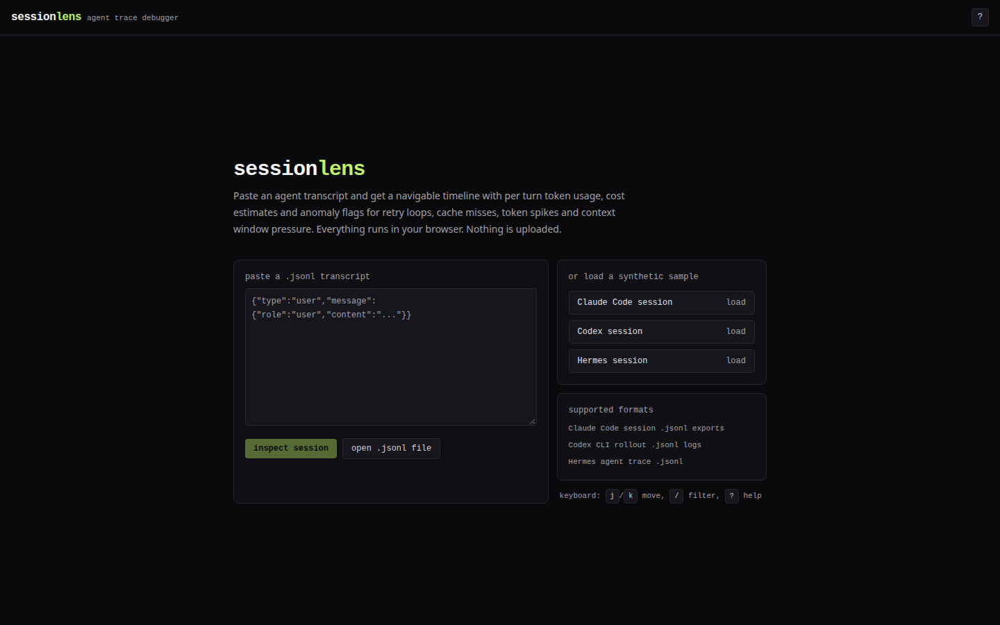
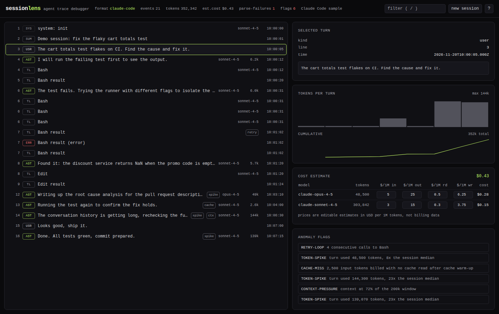

# sessionlens

**Live:** https://yqecea.github.io/sessionlens/

Agent trace and token-cost debugger that runs entirely in your browser.
Paste a `.jsonl` transcript from Claude Code, Codex CLI or Hermes and get a
navigable timeline with per-turn token usage, editable cost estimates and
anomaly flags for retry loops, cache misses, token spikes and context window
pressure. Nothing is uploaded; parsing and analysis happen client-side.





## Why

Agent logs bury the two things that matter most: where the tokens went and
where the run went sideways. sessionlens reads the raw transcript and turns it
into:

- a per-turn token chart plus a cumulative line, so spikes are visible at a glance
- an editable per-model cost table (input / output / cache read / cache write rates)
- anomaly flags pinned to the exact turn: retry loops, cold-cache turns,
  token spikes above the session median, context window pressure
- a detail pane for every event, driven entirely by keyboard

## Supported formats

- Claude Code session `.jsonl` exports
- Codex CLI rollout `.jsonl` logs
- Hermes agent trace `.jsonl`
- anything line-delimited the parser can coerce, with a parse-failure count
  shown in the header so silent drops are visible

## Keyboard

| key | action |
| --- | ------ |
| `j` / `k` | move selection down / up |
| `/` | focus the timeline filter |
| `?` | keyboard shortcut help |
| `Escape` | close help / clear filter |

## Develop

```bash
pnpm install
pnpm dev          # next dev
pnpm test         # vitest unit tests for parsers and analysis
pnpm build        # static export into out/
pnpm test:e2e     # playwright: interaction, axe a11y, console-error gates
pnpm screenshots  # regenerate docs/screenshots/*
```

The e2e suite asserts zero serious/critical axe violations (WCAG AA) and zero
console/page errors on the main view.
